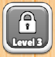
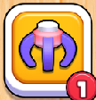
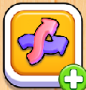
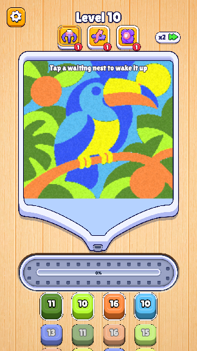
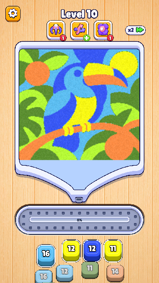
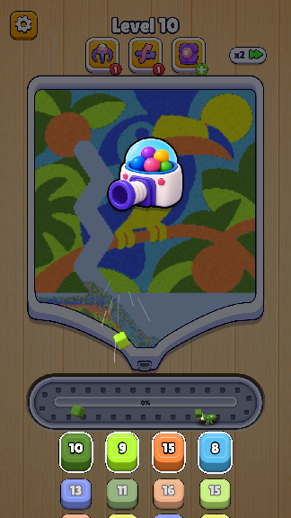
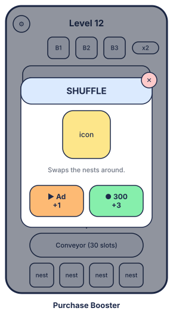

# 3. Booster

| Date | Detail | Publisher |
|---|---|---|
| 2026-11-03 | Document created: the prototype's three boosters (Activate, Shuffle, Fan), their states, and what the Unity game adds (inventory, Fade state, purchase popup, tooltips) | Tuan Dinh Duc |
| 2026-11-05 | Unlock levels 6, 12, 18 (were 3, 6, 9) | Tuan Dinh Duc |

<Badge type="tip" text="Live" /> = in the web prototype now; <Badge type="warning" text="To build" /> = designed here for the Unity game. Where the boosters sit on the screen is in [Core gameplay](./core-gameplay#_4-hud-boosters); the popups are in [User Flow & UI](./user-flow-ui#_6-purchase-booster).

## 1. Boosters

<table class="gdd-table">
<thead><tr><th style="width:24%">Wireframe / reference</th><th style="width:24%">Fakescreen</th><th>Detail</th></tr></thead>
<tbody>
<tr>
<td>

<b>Lock</b> <Badge type="tip" text="Live" />

<b>Number</b> <Badge type="tip" text="Live" />

<b>Add</b> <Badge type="tip" text="Live" />

<b>Fade</b> <Badge type="warning" text="To build" />: the Number state at about 50 % opacity.

</td>
<td>(the booster row, under the level title)</td>
<td>
<h3>Booster states (all boosters)</h3>
<ul>
<li><b>Lock:</b> grey button with a padlock and the unlock level under it ("Level 6"). Tapping it shows "Unlocks at Level N" for a moment.</li>
<li><b>Number:</b> after unlocking, a red badge shows the uses left.</li>
<li><b>Add:</b> with no uses left, a green plus replaces the badge. Tapping it opens the <a href="#purchase">purchase popup</a> <Badge type="warning" text="To build" /> (the prototype only bounces the button).</li>
<li><b>Fade</b> <Badge type="warning" text="To build" />: when the booster can do nothing right now (see each booster), it still shows its number but is faded, and tapping it does nothing but a small shake. The prototype bounces the button and keeps the use.</li>
</ul>

<b>Uses:</b>

<ul>
<li><b>Prototype:</b> each unlocked booster has 1 use per level, refilled every level.</li>
<li><b>Unity</b> <Badge type="warning" text="To build" />: uses are an inventory kept across levels. Unlocking a booster gives 1 free use (shown on the <a href="./user-flow-ui#_4-win">New Feature</a> screen); more come from the purchase popup.</li>
</ul>

<b>While a booster works:</b> the Action Phase takes no other input (Settings, other boosters, swipes). A booster can't be used once the Win or Lose screen is up.

</td>
</tr>
<tr>
<td>
Icon: the claw.
</td>
<td></td>
<td>
<h3>Activate <Badge type="tip" text="Live" /></h3>
<ul>
<li><b>Unlock level 6.</b></li>
<li><b>Text:</b> "Tap a waiting nest to wake it up" (shown at the top of the board while picking).</li>
<li><b>Effect:</b> wakes one nest waiting in the second or third row of a column: ants work for it too, from where it stands, as if it were a front nest, until it is full. A woken nest looks like a front nest (full height, white frame).</li>
<li><b>Pause:</b> after tapping the booster the game holds still while the player picks; the nests that can be woken pulse. Only a nest pick or Cancel is possible.</li>
<li><b>Cancel:</b> tapping the booster again, or anywhere else, cancels. The use is spent only when a nest is woken.</li>
<li><b>Fade when:</b> no nest can be woken (no waiting nest in the second or third row, or all of them are already awake or popping).</li>
</ul>
</td>
</tr>
<tr>
<td>
Icon: two swapping arrows.
</td>
<td></td>
<td>
<h3>Shuffle <Badge type="tip" text="Live" /></h3>
<ul>
<li><b>Unlock level 12.</b></li>
<li><b>Text</b> <Badge type="warning" text="To build" />: "Swap the nests around!" (tooltip on the New Feature screen and in its tutorial).</li>
<li><b>Effect:</b> the nests trade places at random across all columns and rows; each keeps the blocks it already has. At least one place shows a different colour afterwards. Nests with an ant on its way stay put; a woken nest stays woken wherever it lands.</li>
<li><b>Pause:</b> the game holds still and the nests pulse for 0.5 s, then they slide to their new places (about 0.5 s) and play goes on.</li>
<li><b>No cancel:</b> it acts at once.</li>
<li><b>Fade when:</b> the nests it may move all have the same colour (nothing would change).</li>
</ul>
</td>
</tr>
<tr>
<td>
Icon: the flower (button); the ball cannon appears in play.
</td>
<td></td>
<td>
<h3>Fan <Badge type="tip" text="Live" /></h3>
<ul>
<li><b>Unlock level 18</b> (the prototype has 15 levels, so Fan stays locked there for now).</li>
<li><b>Text</b> <Badge type="warning" text="To build" />: "Blow every block into its nest!"</li>
<li><b>Effect:</b> every block on the conveyor goes into a nest of its colour that still has room, upper rows first (nearest column within a row), woken or not. Ants on their way to those blocks go home.</li>
<li><b>Animation:</b> the screen dims (blocks, nests and ants stay lit) and the ball cannon drops into the middle. It sucks the belt's blocks into its mouth one by one, nearest first, with air streaks rushing in, then shoots them out one at a time, 0.2 s apart and 1.5 times their size in flight, kicking back with each shot; it flies off when the last block lands.</li>
<li><b>Pause:</b> the game holds still from the tap until the last block is in its nest.</li>
<li><b>No cancel:</b> it acts at once.</li>
<li><b>Fade when:</b> the conveyor is empty.</li>
<li><b>Also used by Play On:</b> the Out of Space revive fires the same cannon, without using up a Fan.</li>
</ul>
</td>
</tr>
<tr id="purchase">
<td></td>
<td><Badge type="warning" text="To build" /></td>
<td>
<h3>Purchase popup</h3>

In the Add state, tapping a booster opens its popup (the game holds still):

<ul>
<li>The booster's icon, name and one line on what it does.</li>
<li><b>Ad: +1</b>, while the daily ad cap lasts (cap to tune). After the ad, back to the Action Phase with +1.</li>
<li><b>300 coins: +3.</b> Back to the Action Phase with +3. Without enough coins, the button opens More Coins.</li>
<li>✕ closes it without buying.</li>
</ul>
</td>
</tr>
</tbody>
</table>
