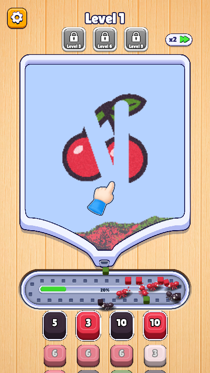
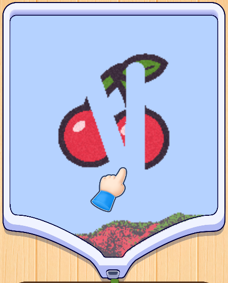
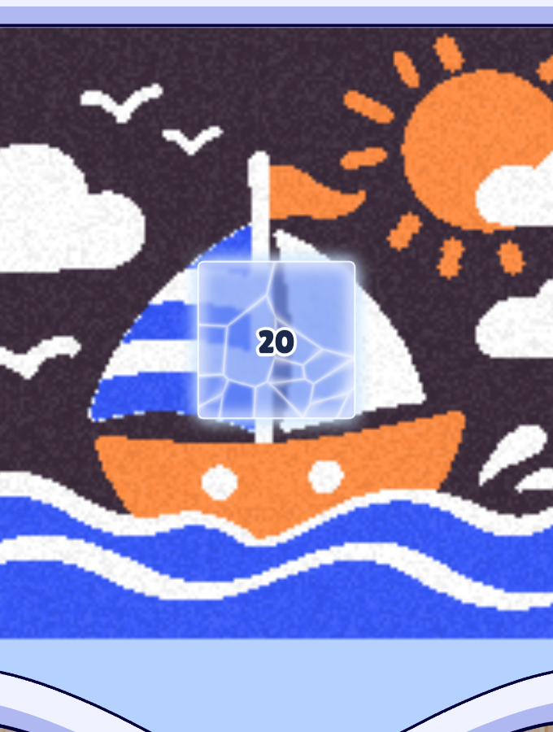
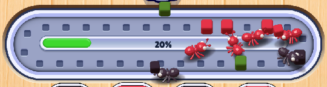
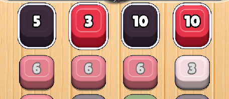
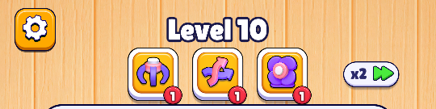
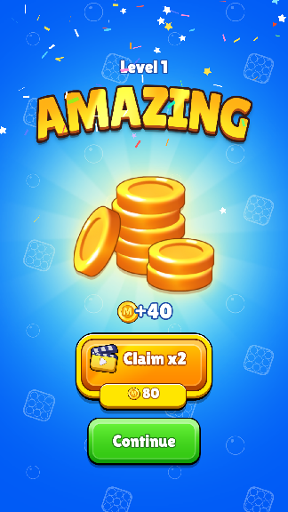
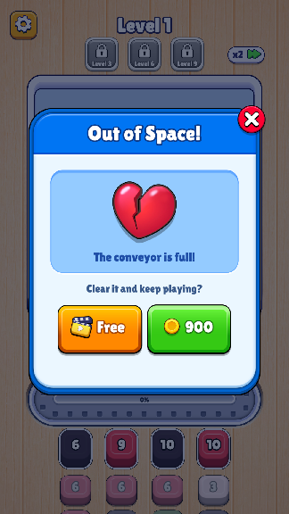

# 1. Core gameplay

| Date | Detail | Author |
|---|---|---|
| 2026-10-27 | Initial design (GDD created) | Tuan Dinh Duc |
| 2026-11-03 | Rewritten in the core gameplay format: an overview, then one table per screen zone | Tuan Dinh Duc |

Every change to the game, build by build, is in the [Changelog](./changelog). Sizes and positions are in world pixels on the 1080 × 1920 portrait game screen; every number comes from the current code (`src/game/layout.ts`, `src/game/sim.ts`).

## I. Overview

<table class="gdd-table">
<thead><tr><th style="width:30%">Fakescreen</th><th>Details</th><th style="width:22%">Demo</th></tr></thead>
<tbody><tr>
<td></td>
<td>

<b>How to play:</b>

<ul>
<li>A picture made of coloured sand fills a frame. The player swipes the sand to set it free.</li>
<li>Freed sand falls into the funnel under the frame and down a hole, where every 64 grains of one colour are pressed into a block.</li>
<li>The blocks come out of the gate under the frame onto a conveyor that runs round and round.</li>
<li>Ant nests wait under the conveyor, each for blocks of one colour. When a block of its colour passes, an ant walks out, takes it and carries it home, and the number on the nest counts down.</li>
<li>A full nest pops and the next nest in its column moves up.</li>
<li>The tension: the conveyor has 30 slots. Releasing a colour no front nest wants fills it up.</li>
</ul>

<b>Win:</b>

<ul><li>Every nest has all its blocks.</li></ul>

<b>Lose:</b>

<ul><li>All 30 conveyor slots hold a block and none of them can go into a nest any more (no front nest wants a colour on the belt, no ant is on its way and no nest is popping) for more than 0.35 s: <b>Out of Space!</b></li></ul>

<b>Session:</b> a level takes about 30 to 150 seconds. The last level reached is remembered.

</td>
<td>

<b>Play:</b> <a href="https://tuandds.github.io/colony-flow-sand/demo/" target="_blank">demo</a>

<b>Gameplay reels</b> (the game plays itself): <a href="https://tuandds.github.io/colony-flow-sand/demo/?demo=drops30" target="_blank">drops30</a>, <a href="https://tuandds.github.io/colony-flow-sand/demo/?demo=mix60" target="_blank">mix60</a>; see <a href="../guide/demo-videos">Demo Videos</a>

<b>Level Editor:</b> <a href="https://tuandds.github.io/colony-flow-sand/demo/editor.html" target="_blank">editor</a>

</td>
</tr></tbody>
</table>

**Screen layout** (top to bottom):

| Zone | Share of the screen height | Position (y) |
|---|---|---|
| [4. HUD & boosters](#_4-hud-boosters) | about 14 % | 0 – 270 |
| [1. Sand board & funnel](#_1-sand-board-funnel) | about 57 % | 279 – 1378 |
| [2. Conveyor](#_2-conveyor) | about 12 % | 1380 – 1604 |
| [3. Nests & ants](#_3-nests-ants) | about 17 % (two rows and a half on screen) | 1604 – 1920 |

## 1. Sand board & funnel

<table class="gdd-table">
<thead><tr><th style="width:30%">Fakescreen</th><th>Details</th></tr></thead>
<tbody><tr>
<td></td>
<td>

<b>Structure:</b> about 57 % of the screen height: the picture frame and its funnel, one piece of art (<code>img/frame.png</code>).

<ul>
<li><b>Board:</b> the frame's inside, 824 × 776 px at (128, 330), under the frame's lilac top band. Its corners are rounded like the art's (the top corners of the light blue, and the bottom corners where they begin to curve into the funnel); no sand goes there.</li>
<li><b>Picture:</b> up to 188 × 176 grains (22 cells tall; a cell is 8 × 8 grains, 35 px; a grain is about 4.4 px). The scale is the same in every level; a smaller picture sits centred. A full frame is exactly 517 blocks.</li>
<li><b>Colours:</b> each level uses its own few colours from the Colour Bank (4 to 6 in the current levels, up to 12).</li>
<li><b>Inner stroke:</b> a dark stroke runs along the inside's edge, from under the top band down the sides and the funnel to the spout. It is drawn over the sand, so it shows even where a picture fills the frame.</li>
<li><b>Funnel:</b> as wide as the board at the top (824 px), its sides curve in, as the art's do, to the hole (about 75 px wide) 183 px under the board. The spout ends over the <b>gate</b> at the bottom of the frame, just above the conveyor.</li>
</ul>

<b>Sand:</b>

<ul>
<li>Sand is <b>fixed</b> until swiped. A swipe frees the sand within 38.5 px of the finger (1.1 cells); freed sand is <b>loose</b> and drawn 22 % brighter.</li>
<li>Loose sand falls with gravity 0.09 grains/step² up to 3.5 grains/step, at 110 steps per second. Blocked below, it slides down-left or down-right; on gentle slopes it creeps sideways toward a drop within 2 grains, with friction 0.82.</li>
<li>Small or thin islands of fixed sand (48 grains or fewer, or narrower than 4 grains) come loose by themselves every 0.5 s.</li>
<li><b>The picture plays as drawn:</b> no grain is added, removed or recoloured when a level loads. Every 64 grains of a colour make a block, and a colour's leftover grains make its last block, so each colour makes its grains ÷ 64 blocks, rounded up.</li>
</ul>

<b>Funnel and hole:</b>

<ul>
<li>The board and the funnel are <b>one sand pile</b>: the same grains fall from the board straight on into the funnel. Its curved sides are walls that loose sand slides down toward the hole.</li>
<li><b>First down, first out:</b> grains are numbered as they come into the funnel and move oldest first; the hole takes the oldest grains first. Sand comes out within about 3 blocks of the order it came down in.</li>
<li>The hole takes 540 grains per second, but only while no finished block is waiting in it. Each colour is pressed on its own: a colour's sand waits under the hole until it has 64 grains (or its last grain is down).</li>
<li>When the hole is plugged or slower than the sand coming in, the funnel fills up and the sand piles back up into the board.</li>
</ul>

<b>Position:</b> centred under the HUD; its gate sits just above the conveyor.

</td>
</tr>
<tr>
<td></td>
<td>
<h3 id="obstacle-frozen">Obstacle: Frozen <Badge type="tip" text="Live" /></h3>

A patch of the picture locked under a sheet of ice, with a number on it.

<ul>
<li><b>Shape:</b> a square/rectangle or a circle/ellipse, placed in picture grains (<code>frozen</code> in the level: <code>shape</code> <code>rect</code> or <code>circle</code>, <code>x</code>, <code>y</code>, <code>w</code>, <code>h</code>, <code>count</code>). A level may have several.</li>
<li><b>Locked:</b> the sand under the ice cannot be swept and never comes loose by itself (small islands next to it still do). Falling sand cannot enter it, so loose sand piles up on top of it.</li>
<li><b>Count:</b> the number goes down by 1 each time a nest is removed (a full nest pops and leaves its column). It pops a little each time it changes.</li>
<li><b>Break:</b> at 0 the ice shatters: its shards fly out and fall, the sheet fades out, and the sand it held becomes ordinary fixed sand that the player can sweep.</li>
<li><b>Look:</b> clear blue ice: the picture under it shows through, softened and tinted blue, so its pattern and colours can still be made out. It is cracked into pale cells, glows white along the inside of its edge and softly round its outside; a dark number with a white outline in the middle.</li>
<li><b>Level Editor:</b> the ❄️ tool (<code>F</code>) draws, moves and resizes areas on the picture; the Frozen section sets each one's shape, count and size, or deletes it (see the <a href="../guide/level-editor">Level Editor guide</a>). Areas show on the Sand Editor as a dashed outline with ❄ and the count.</li>
<li><b>In the levels:</b> level_6, one 44 × 44 grain square on the sail, count 20.</li>
</ul>
</td>
</tr></tbody>
</table>

## 2. Conveyor

<table class="gdd-table">
<thead><tr><th style="width:30%">Fakescreen</th><th>Details</th></tr></thead>
<tbody><tr>
<td></td>
<td>

<b>Structure:</b> about 12 % of the screen height.

<ul>
<li>A loop track: straight runs from x 203 to 877, round ends of radius 50, centred at y 1492. The belt art (<code>img/conveyor.png</code>) is drawn with its own hollow in the wood round it.</li>
<li><b>30 slots</b>, each with a holder (a dark slate square); a block is a 32 px cube.</li>
<li>A fill gauge in the middle shows how full the belt is (a green bar and a percentage).</li>
</ul>

<b>Behaviour:</b>

<ul>
<li>The belt runs at 300 px/s.</li>
<li>A finished block waits in the gate's opening until an empty slot passes under it, then drops onto the belt.</li>
<li>Blocks ride round until an ant takes them. A full belt is not a loss while ants can still take blocks off it (see <a href="#i-overview">Lose</a>).</li>
</ul>

<b>Position:</b> between the sand board's gate and the nests.

</td>
</tr></tbody>
</table>

## 3. Nests & ants

<table class="gdd-table">
<thead><tr><th style="width:30%">Fakescreen</th><th>Details</th></tr></thead>
<tbody><tr>
<td></td>
<td>

<b>Structure:</b> about 17 % of the screen height: two rows of nests and the third down to its number; the rest wait below the screen.

<ul>
<li><b>Columns:</b> 4 (a level from the Level Editor can have 2 to 6), 172 px apart. Rows are 130 px apart, with 28 px more under the front row.</li>
<li><b>Nest:</b> a box in its colour showing how many blocks it still needs (a white number with a black stroke). Front nests are full height in a white frame; waiting nests are lower and paler.</li>
<li><b>Nest sizes:</b> set by hand in the Level Editor, or built by the game from the picture: the blocks are listed in the order the sand naturally comes out, cut into nests of <code>chunk × 2</code> blocks and dealt to the column with the least sand still queued.</li>
</ul>

<b>Behaviour:</b>

<ul>
<li>Only the front nest of each column is active (and nests woken by the Activate booster).</li>
<li>An ant leaves an active nest every 0.12 s while it still needs blocks and a matching block is on the belt. Ants walk at 420 px/s, are 74 px long and carry 26 px cubes.</li>
<li>Each ant leaves from its own spot on the nest's top edge (up to ±38 px from the centre) and heads off its block: it aims at a point a random 25–100 % of the way to where it would meet the block, so some ants chase their block and others cut across. Both come from the level's seeded random numbers, so a recorded play replays the same.</li>
<li>A full nest pops; the column slides up. Nests never change column.</li>
</ul>

<b>Position:</b> under the conveyor, to the bottom of the screen.

</td>
</tr></tbody>
</table>

## 4. HUD & boosters

<table class="gdd-table">
<thead><tr><th style="width:30%">Fakescreen</th><th>Details</th></tr></thead>
<tbody><tr>
<td></td>
<td>

<b>Structure:</b> about 14 % of the screen height.

<ul>
<li><b>Settings button</b> (top left): the pause panel: close (resume), music, sound and vibration switches (kept in the browser), Restart, Home, and a cheat to jump to any level. Vibration buzzes when a nest fills, on a win and on a loss.</li>
<li><b>Level title:</b> "Level N".</li>
<li><b>Boosters:</b> a row of three 126 px buttons under the title, each with 1 use per level on a red badge (a green plus when none are left). They unlock one by one: Activate at level 3, Shuffle at level 6, Fan at level 9; before that the button is grey with a padlock and its level, and tapping it shows "Unlocks at Level N".</li>
<li><b>x2:</b> double speed. Once all the sand has fallen off the picture, x2 turns on by itself and the button hides until the next level.</li>
</ul>

<b>Boosters:</b>

<ul>
<li><b>Activate</b> (the claw): tap it, then a nest waiting in the second or third row; ants work for that nest too, from where it stands, until it is full. The game holds still while you pick.</li>
<li><b>Shuffle:</b> the game holds still and the nests pulse; after 0.5 s they trade places at random (each keeps its blocks), sliding to their new places in about 0.5 s. Nests with an ant on its way stay put.</li>
<li><b>Fan</b> (the ball cannon): the screen dims and the cannon drops into the middle, sucks the conveyor's blocks into its mouth one by one, then shoots them, 0.2 s apart, into nests of their colour that still have room, upper rows first. The game holds still until the last block lands.</li>
<li>A booster that would do nothing (nothing to wake, swap or blow) only bounces and keeps its use.</li>
</ul>

<b>Desktop testing keys:</b> N / P next and previous level, R restart.

</td>
</tr></tbody>
</table>

## 5. Result screens

<table class="gdd-table">
<thead><tr><th style="width:30%">Fakescreen</th><th>Details</th></tr></thead>
<tbody><tr>
<td> </td>
<td>

<b>Win:</b> a blue background, "Level N" over the "AMAZING" title, a pile of coins in a glow with turning rays, "+40" coins and confetti. <b>Claim x2</b> (ad badge, 80 coins) and <b>Continue</b> both go on to the next level (no coins or ads yet).

<b>Out of Space!</b> (the conveyor is full): a broken heart and two revives, <b>Free</b> (ad) and <b>900</b> coins. Either one closes the board and the ball cannon clears the belt into the nests (it does not use up the Fan booster), then play goes on. The ✕ gives up.

<b>Level failed:</b> after giving up, a board shows the lives (four hearts and a blank one), the time to the next heart and "Level failed!"; <b>Try Again</b> starts the level over (lives are only shown for now).

</td>
</tr></tbody>
</table>
