# 5. FTUE & Tutorial

| Date | Detail | Author |
|---|---|---|
| 2026-11-09 | Initial: level 1's first-time tutorial, the conveyor warning, the booster tutorials (levels 6, 12, 18) and the obstacle tutorials (levels 5, 10) | Tuan Dinh Duc |

All of this is <Badge type="warning" text="To build" /> for the Unity game. The web prototype has the hand and its swipe and tap paths from the demo reels ([Demo videos](../guide/demo-videos)), but no tutorial. Where each screen sits in the flow is in [User Flow & UI](./user-flow-ui); the boosters are in [Booster](./booster), the obstacles in [Obstacles](./obstacles).

**For every tutorial:**
- **Text:** shown in a white bubble over the step. It has an idle zoom in and out. All texts are placeholders to tune.
- **Hard tut:** the screen dims except the thing to touch. The hand shows the move, and only that move works. Settings stays usable, so the player can still change sound and vibration.
- **Soft tut:** no dim, nothing is blocked; the hand only shows a move.

[[toc]]

## 1. FTUE

<table class="gdd-table">
<thead><tr><th style="width:18%">UI Clone</th><th style="width:34%">Wireframe</th><th>Detail</th></tr></thead>
<tbody>
<tr>
<td>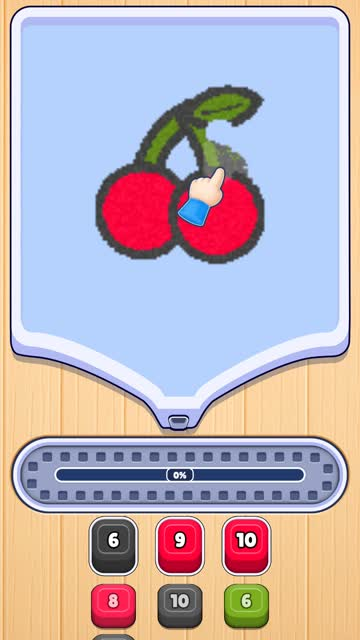
The prototype's hand guide (demo reels).
</td>
<td>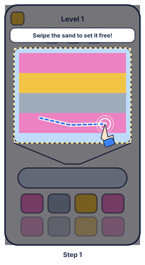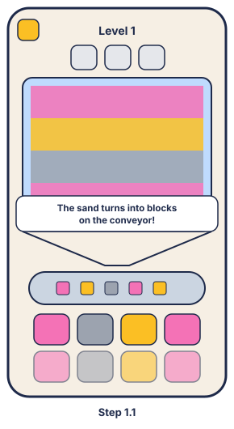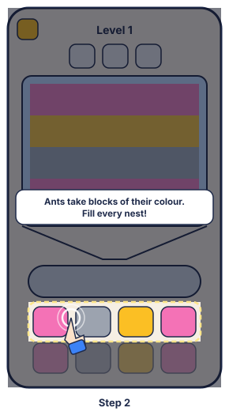</td>
<td>
<h3>Level 1</h3>

<b>Step 1</b> (hard tut):

<ul>
<li>The game opens straight into level 1 (there is no Home screen).</li>
<li>The screen dims except the sand board. Over it: "<code>Swipe the sand to set it free!</code>"</li>
<li>The hand swipes across the bottom of the picture, along a path the player can follow (a stroke from the bot, as in the demo reels), again and again until the player swipes.</li>
<li>Any swipe that frees sand counts. The dim lifts.</li>
</ul>

<b>Step 1.1:</b>

<ul>
<li>While the freed sand falls down the funnel and the first blocks come out onto the conveyor, the board takes no swipes (about 2 s).</li>
<li>Text: "<code>The sand turns into blocks on the conveyor!</code>"</li>
</ul>

<b>Step 2</b> (hard tut):

<ul>
<li>As the first ant walks out for a block, the screen dims except the front nests. Text: "<code>Ants take blocks of their colour. Fill every nest!</code>"</li>
<li>The hand points at the nest whose ant is on its way.</li>
<li>When that ant brings its block home (or after 3 s), the tutorial ends and the player plays freely.</li>
</ul>

<b>Note:</b>

<ul>
<li>If the player does nothing for 5 s, the hand shows a good swipe (soft tut), until the next swipe.</li>
<li>A restart shows the FTUE again, until level 1 is won once.</li>
<li>Killing the game during it: the next launch starts level 1 and the FTUE again.</li>
</ul>
</td>
</tr>
<tr>
<td>(the conveyor's fill gauge turns deep orange at 80 %, see <a href="./core-gameplay">Core gameplay</a>)</td>
<td>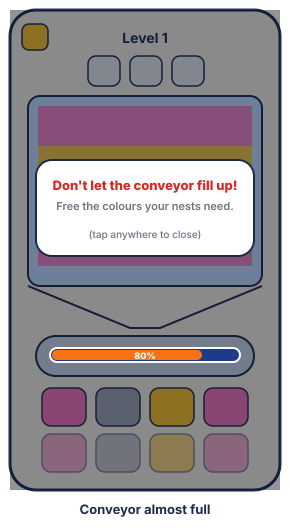</td>
<td>
<h3>Conveyor almost full (first time)</h3>
<ul>
<li>The first time the conveyor reaches 80 %, the game holds still and a popup shows: "<code>Don't let the conveyor fill up!</code>" and "<code>Free the colours your nests need.</code>"</li>
<li>Tapping anywhere closes it and play goes on.</li>
<li>Once only, on any level (kept on the device).</li>
</ul>
</td>
</tr>
</tbody>
</table>

## 2. Booster Tutorial

<table class="gdd-table">
<thead><tr><th style="width:18%">Reference</th><th style="width:34%">Wireframe</th><th>Detail</th></tr></thead>
<tbody>
<tr>
<td>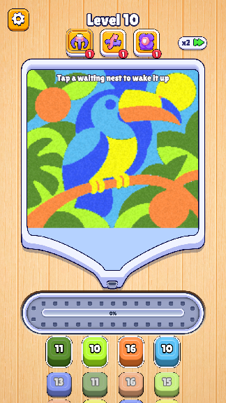
<b>Anim:</b> sparkles round the icon on the popup; the icon flies into its button after Claim.
</td>
<td>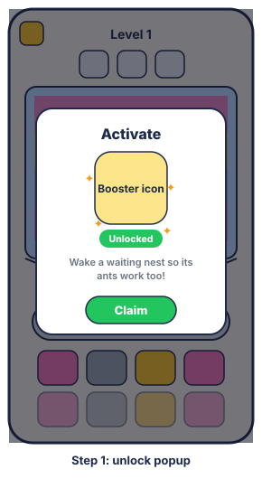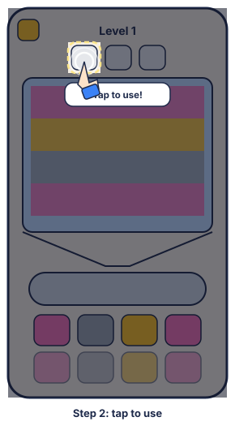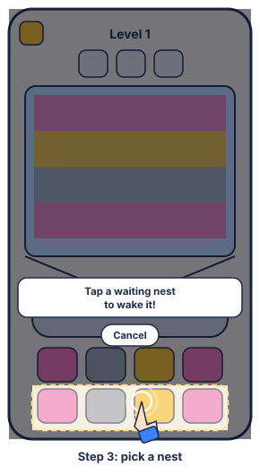</td>
<td>
<h3>Level 6: Activate</h3>

<b>Step 1, the unlock popup:</b> as the level opens:

<ul>
<li>Title "<code>Activate</code>"; the booster's icon with an "Unlocked" tag and sparkles round it.</li>
<li>Text: "<code>Wake a waiting nest so its ants work too!</code>"</li>
<li><b>Claim</b> closes the popup and gives 1 Activate: its icon flies into the booster's button, whose badge counts up.</li>
</ul>

<b>Tut:</b> it starts once a nest can be woken (a waiting nest in the second or third row).

<ul>
<li><b>Step 2</b> (hard tut): the screen dims except the Activate button. Text: "<code>Tap to use!</code>". The hand taps the button, with a ripple at the fingertip, moving in and out.</li>
<li><b>Step 3:</b> after the tap, the game holds still and the nests that can be woken pulse. Text: "<code>Tap a waiting nest to wake it!</code>". The hand points at one. <b>Cancel</b> is there if the player doesn't want it now.</li>
<li>The tutorial ends when a nest is woken or on Cancel. This use is free.</li>
</ul>
</td>
</tr>
<tr>
<td>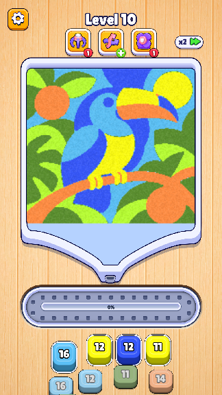</td>
<td></td>
<td>
<h3>Level 12: Shuffle</h3>

<b>Unlock popup</b> as for Activate: "<code>Shuffle</code>", "Unlocked", "<code>Swap the nests around to find the colours you need!</code>", <b>Claim</b> gives 1.

<b>Tut:</b> it starts once Shuffle can change something.

<ul>
<li>The screen dims except the Shuffle button. Text: "<code>Tap to use!</code>". The hand taps it (ripple, in and out).</li>
<li>After the tap the shuffle plays, the dim lifts and the tutorial ends. This use is free.</li>
</ul>
</td>
</tr>
<tr>
<td>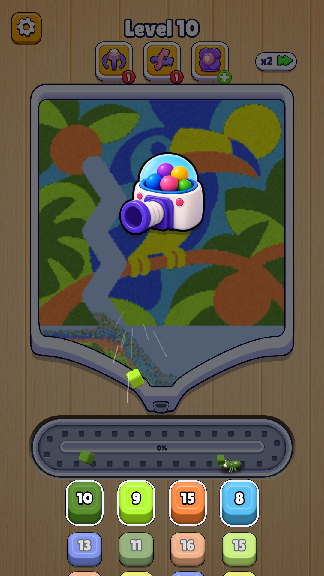</td>
<td></td>
<td>
<h3>Level 18: Fan</h3>

<b>Unlock popup</b> as for Activate: "<code>Fan</code>", "Unlocked", "<code>Blow every block on the conveyor into its nest!</code>", <b>Claim</b> gives 1.

<b>Tut:</b> it waits until the conveyor holds several blocks (at least 30 %), so the Fan has something to clear.

<ul>
<li>The screen dims except the Fan button. Text: "<code>Tap to use!</code>". The hand taps it (ripple, in and out).</li>
<li>After the tap the cannon plays, the dim lifts and the tutorial ends. This use is free.</li>
</ul>
</td>
</tr>
</tbody>
</table>

**For every booster tutorial:**
- **Kill the game during it:** the next time the level opens, the tutorial starts again; the popup does not show twice.
- **Busy board:** if the Win or Lose screen comes up before the tutorial starts, it waits for the next level.

## 3. Obstacles

<table class="gdd-table">
<thead><tr><th style="width:34%">Wireframes</th><th style="width:18%">Clone</th><th>Detail</th></tr></thead>
<tbody>
<tr>
<td>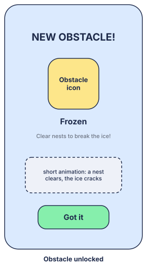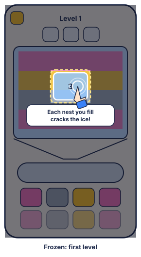</td>
<td>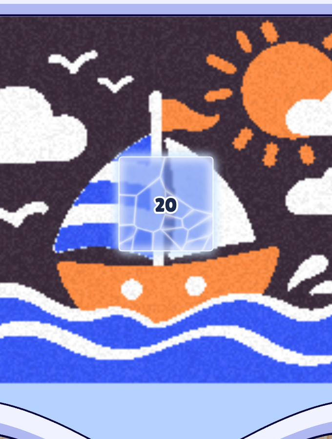</td>
<td>
<h3>Level 5: Frozen</h3>
<ul>
<li>As the level opens, the <a href="./obstacles#_2-new-features">Obstacle Unlocked</a> popup: "<code>NEW OBSTACLE!</code>", Frozen's picture, "<code>Clear nests to break the ice!</code>", and a short animation (a nest fills, the ice cracks and its number drops). <b>Got it</b> closes it.</li>
<li><b>Hint</b> (soft tut, once): the screen dims except the ice for 2 s, with "<code>Each nest you fill cracks the ice!</code>" and the hand pointing at its number. Any touch ends it.</li>
</ul>
</td>
</tr>
<tr>
<td>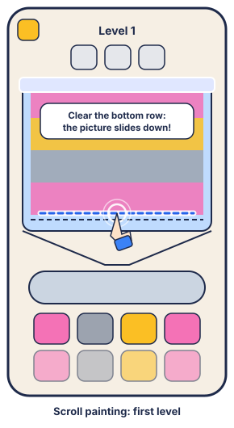</td>
<td>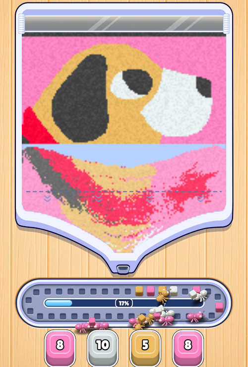</td>
<td>
<h3>Level 10: Scroll painting</h3>
<ul>
<li>As the level opens, the Obstacle Unlocked popup: "<code>NEW OBSTACLE!</code>", "<code>There's more picture above!</code>", and a short animation (the bottom row is swept, the picture slides down and the roller turns). <b>Got it</b> closes it.</li>
<li><b>Hint</b> (soft tut, once): text "<code>Clear the bottom row: the picture slides down!</code>". The hand swipes along the limit line until the player swipes.</li>
<li>When the picture first slides, the glass roller glows once.</li>
</ul>
</td>
</tr>
</tbody>
</table>
