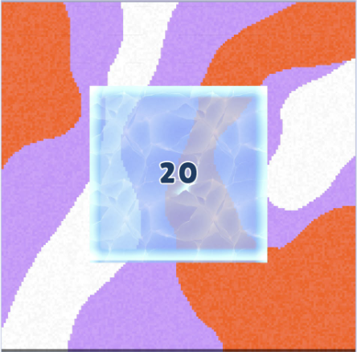
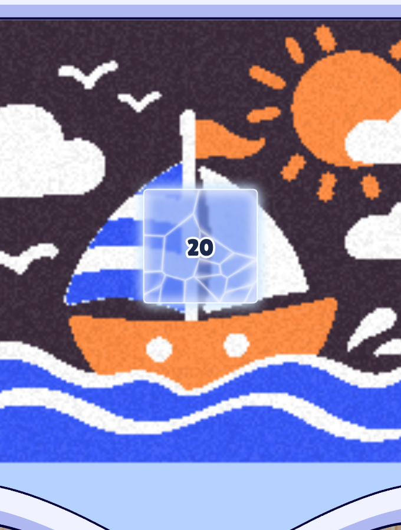
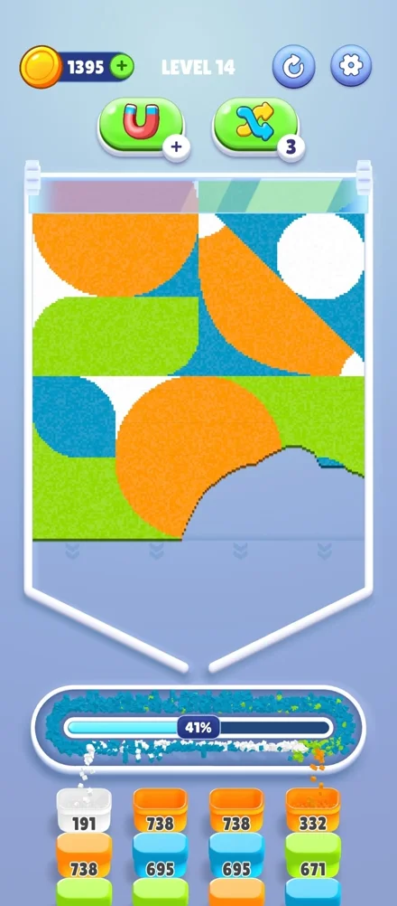
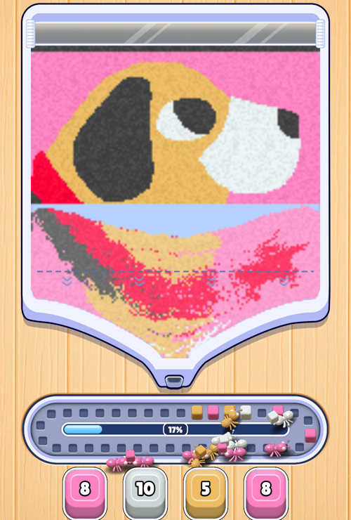
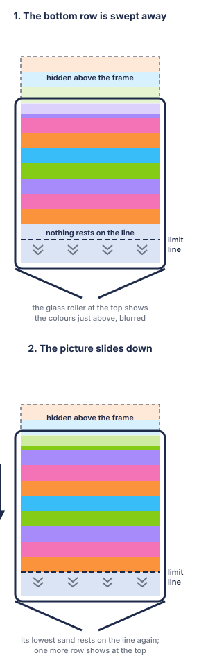
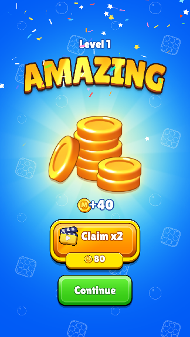
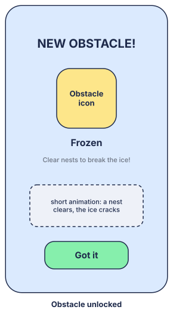

# 4. Obstacles

| Date | Detail | Publisher |
|---|---|---|
| 2026-11-05 | Document created: Frozen and Scroll painting, their unlock levels and the Obstacle Unlocked screen | Tuan Dinh Duc |
| 2026-11-05 | Unlock order with the boosters' new levels (6, 12, 18) | Tuan Dinh Duc |
| 2026-11-05 | Scroll painting is in the prototype: the game and the Level Editor | Tuan Dinh Duc |

<Badge type="tip" text="Live" /> = in the web prototype now; <Badge type="warning" text="To build" /> = designed here for the Unity game. How the board itself works (sand, funnel, conveyor, nests) is in [Core gameplay](./core-gameplay); the screens around a level are in [User Flow & UI](./user-flow-ui).

[[toc]]

## 1. Obstacles List

<table class="gdd-table">
<thead><tr><th style="width:13%">Name</th><th style="width:19%">UI Clone</th><th style="width:19%">Fakescreen</th><th>Detail</th></tr></thead>
<tbody>
<tr>
<td>
<h3 id="frozen">Frozen</h3>

Level 5

<Badge type="tip" text="Live" />
</td>
<td></td>
<td></td>
<td>

<b>Structure:</b>

<ul>
<li>An area of the sand picture under a sheet of ice, with a number in the middle. It is a square or rectangle or a circle or ellipse, set in picture grains. A level can have several.</li>
<li>Clear blue ice: the picture under it shows through, softened and tinted blue, so the player can see which colours are locked. The ice is cracked into pale cells and glows white along its edge. The number is dark with a white outline.</li>
</ul>

<b>Mechanic:</b>

<ul>
<li><b>Locked:</b> the sand under the ice cannot be swept and never comes loose. Falling sand cannot pass through it, so loose sand piles up on top of it.</li>
<li><b>Count down:</b> each time a nest is cleared (a full nest pops and leaves its column), every Frozen area on the board goes down by 1. Each step plays a crack animation: new cracks spread over the ice, a few chips fly off, and the number pops. <Badge type="warning" text="To build" /> The prototype only pops the number.</li>
<li><b>Break:</b> at 0 the ice shatters. Its shards fly out and fall, the sheet fades out, and the area disappears. The sand it held becomes ordinary sand that the player can sweep.</li>
<li><b>Boosters:</b> they do not act on Frozen directly. A nest that a booster or Play On fills and clears still counts it down.</li>
<li><b>Scroll painting:</b> on a scroll painting, the ice moves down with the picture.</li>
</ul>

<b>Level design:</b>

<ul>
<li>The count must be reachable. Enough nests must be clearable without the locked sand: no nest at the front of the queue may wait only for colours that are under the ice.</li>
<li>The count is set per area in the Level Editor: the ❄️ tool (<code>F</code>) draws, moves and resizes areas; the Frozen section sets shape, count and size.</li>
</ul>
</td>
</tr>
<tr>
<td>
<h3 id="scroll-painting">Scroll painting</h3>

Level 10

<Badge type="tip" text="Live" />
</td>
<td></td>
<td></td>
<td>

<b>Structure:</b>

<ul>
<li>The sand picture is taller than the frame, for example 136 × 200 grains in a frame that shows 128 rows. The frame shows only the bottom part; the rest is hidden above the frame's top edge.</li>
<li>A <b>limit line</b> runs across the bottom of the frame: a dashed line with small down chevrons under it. The picture's lowest sand rests on it.</li>
<li>A <b>glass roller</b> lies across the top of the frame, like the rod of a hanging scroll: clear glass with slanting sheen bands, white rims and a ridged cap at each end. As the picture slides down, the caps turn: their ridges run down the front, as far as the picture moves, and thin out as they go round. Through it show the colours hidden just above, blurred into broad pale patches, so the player can tell what is coming but not its detail. The picture shows from under the roller.</li>
</ul>

<b>Mechanic:</b>

<ul>
<li>The player sweeps sand as usual. Once none of the picture's fixed sand touches the limit line (its lowest grain anywhere across the width is above the line), the whole picture slides down as one piece until its lowest grain touches the line again. The slide is smooth and eases out; its speed is to tune.</li>
<li>As the picture slides, new rows come into view at the top of the frame. When its top edge is inside the frame, nothing is hidden any more and the picture keeps resting on the line.</li>
<li>Only the fixed picture moves. Sand already falling keeps falling, and the player can keep swiping during the slide.</li>
<li><b>Prototype values:</b> the line is 10 grains (about 60 px) above the board's bottom; the slide starts 0.2 s after nothing rests on the line (so sand just swept falls away first) and runs at 45 grain rows a second. Loose sand piled up under the picture (a full funnel) holds it up until it drains. The roller covers the frame's top 11 grain rows (about 66 px, and the frame's rounded top corners); it shows the next 24 hidden rows, averaged in patches of 4 × 8 grains, washed 30 % toward white and smoothed. Once nothing is hidden it shows the frame's light blue.</li>
<li><b>Nests</b> count the whole picture, the hidden part too. A nest may ask for a colour that is not in view yet.</li>
<li><b>Win:</b> when every nest is full. That needs all the sand, the hidden part included.</li>
<li><b>Boosters:</b> they do not act on the scroll directly.</li>
</ul>

<b>Level design:</b>

<ul>
<li>The level sets the picture's height: in the Level Editor, <b>Tranh cuộn (cao)</b> in Settings, from the frame's height (128 grains at 1×; fits the frame, no scroll) to 384. A taller picture is a scroll painting: the frame first shows its bottom 107 rows (the frame's 128 less the roller's 11 and the 10 under the limit line). The Sand Editor shows the whole picture: the part hidden at the start is shaded above a dashed orange line, and the limit line is its bottom edge.</li>
<li>Scroll paintings work at any grain zoom. With bigger grains, the roller, the gap under the limit line and the slide speed keep their size and speed on screen: about 11, 10 and 45 grains at 1×, fewer at a zoom (8, 7 and 33 at 1.35×). A zoomed scroll painting is as wide as that zoom's frame (101 grains at 1.35×) and carries its zoom in the level (<code>sand.zoom</code>), since its size alone can't tell it.</li>
<li>A long image makes one directly: <b>Tranh cuộn (ảnh dài)</b> in the Level Editor's image generator. The picture fills the frame's width, and its height follows the image's shape, up to 384 grains.</li>
<li>Frozen areas in the hidden part come into view as the picture slides; their ice shows once it is wholly out from under the roller, and still counts down while hidden.</li>
</ul>
</td>
</tr>
</tbody>
</table>

## 2. New Features

<table class="gdd-table">
<thead><tr><th style="width:24%">Ref</th><th style="width:24%">Wireframe</th><th>Detail</th></tr></thead>
<tbody>
<tr>
<td>(the Win screen's progress bar)</td>
<td></td>
<td>

Shown on the <a href="./user-flow-ui#_3-win">Win</a> screen. <b>Next feature</b>, boosters and obstacles in one list:

<ul>
<li>Lv 5: Frozen</li>
<li>Lv 6: Activate (booster)</li>
<li>Lv 10: Scroll painting</li>
<li>Lv 12: Shuffle (booster)</li>
<li>Lv 18: Fan (booster)</li>
</ul>
</td>
</tr>
<tr>
<td>(as the New Feature screen for boosters)</td>
<td></td>
<td>

<b>Obstacle Unlocked:</b> when a level brings a new obstacle, this popup shows as that level opens, over it, before play starts (then its hint, see <a href="./ftue-tutorial#_3-obstacles">FTUE & Tutorial</a>).

<ul>
<li>"NEW OBSTACLE!", the obstacle's picture and name, one line on it, and a short animation of it at work.</li>
<li><b>Got it:</b> opens the level. On that first level, a hint points at the obstacle once.</li>
<li>If the player kills the game on the Win screen before this screen shows, the next launch shows it over the level before play starts.</li>
</ul>

<b>Text:</b>

<ul>
<li>Frozen: "Clear nests to break the ice!"</li>
<li>Scroll painting: "There's more picture above!"</li>
</ul>
</td>
</tr>
</tbody>
</table>
