# 2. User Flow & UI

| Date | Detail | Publisher |
|---|---|---|
| 2026-11-03 | Document created: the web prototype's screens, plus the screens the Unity game needs that the prototype does not have yet | Tuan Dinh Duc |
| 2026-11-05 | No Home (lobby) screen: the game opens straight into the current level, a win always goes on to the next level, and the More Coins popup (reached from Home) is gone | Tuan Dinh Duc |
| 2026-11-09 | Tutorial and New Feature point to the new FTUE & Tutorial chapter; the unlock popup shows as the level opens, with Claim | Tuan Dinh Duc |
| 2026-11-09 | Coins in the prototype: the coin panel, Win's coins flying into it, Out of Space paid with coins, and the Purchase Booster popup (Live) | Tuan Dinh Duc |

This page is the reference for building the game's screens in Unity. Each screen is marked:

| Mark | Meaning |
|---|---|
| <Badge type="tip" text="Live" /> | In the web prototype now ([play it](https://tuandds.github.io/colony-flow-sand/demo/)); the wireframe is a screenshot of it. |
| <Badge type="warning" text="To build" /> | Not in the prototype; designed here for the Unity game. The wireframe is a sketch: layout and content, not final art. |

How the game itself plays (sand board, conveyor, nests, boosters) is in [Core gameplay](./core-gameplay).

[[toc]]

## Simple WireFlow

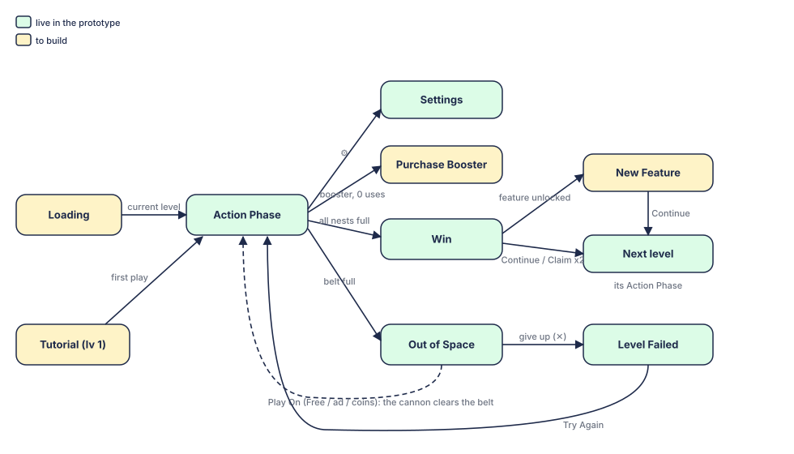

- **No Home (lobby) screen:** the game is always in a level. Launch: Loading → the current level's Action Phase; the very first play starts with the Tutorial. A win goes on to the next level; a loss replays the level.
- **Between screens:** every change of level (Loading → level, level → level) plays the [Loading transition](#_7-loading-transition).

## 1. Action Phase <Badge type="tip" text="Live" />

<table class="gdd-table">
<thead><tr><th style="width:26%">Wireframe</th><th style="width:16%">Compare</th><th>Detail</th></tr></thead>
<tbody><tr>
<td>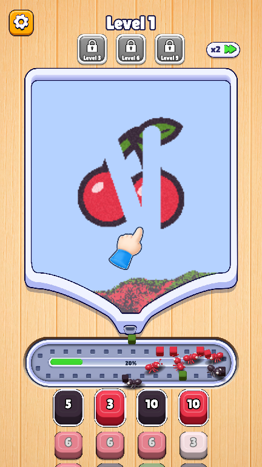</td>
<td>Prototype screen (live).</td>
<td>

<b>Action Phase:</b> a level has 5 parts (sizes and rules in <a href="./core-gameplay">Core gameplay</a>):

<ul>
<li><b>Top UI</b> (about 14 % of the screen): Settings (pauses the game), the level title "Level N", the x2 speed button.</li>
<li><b>Boosters:</b> a row of three under the title: Activate, Shuffle, Fan (unlock at levels 6, 12, 18). A booster with no uses left shows a green plus and opens <a href="#_5-purchase-booster">Purchase Booster</a>.</li>
<li><b>Sand board & funnel</b> (about 57 %): the sand picture; the player swipes it to free the sand. The funnel ends in a gate just above the conveyor.</li>
<li><b>Conveyor</b> (about 12 %): 36 slots; blocks come out of the gate onto it.</li>
<li><b>Nests</b> (about 17 %): 4 columns of ant nests; two rows and a half show.</li>
</ul>

<b>Win & Lose:</b>

<ul>
<li>Win when the last nest is full: the <a href="#_3-win">Win</a> screen shows 0.9 s later.</li>
<li>Lose when the conveyor is full and no block on it fits a nest (after a 0.35 s grace): <a href="#_4-lose">Out of Space</a>. <b>Unity:</b> show the popup 0.75 s after the loss, so the player sees the full belt first.</li>
<li>Once the Win or Lose screen is up, the Settings button, the board and the boosters do not take input.</li>
</ul>

<b>Kill game</b> <Badge type="warning" text="To build" />:

<ul>
<li>Killed during a level: the next launch starts that level again.</li>
<li>Killed during a forced tutorial: the tutorial runs again. A tutorial popup that was already shown does not show again.</li>
<li>Killed after the last nest filled: the level counts as won; the next launch opens the next level.</li>
</ul>
</td>
</tr></tbody>
</table>

## 2. Settings

<table class="gdd-table">
<thead><tr><th style="width:26%">Wireframe</th><th style="width:16%">Compare</th><th>Detail</th></tr></thead>
<tbody>
<tr>
<td>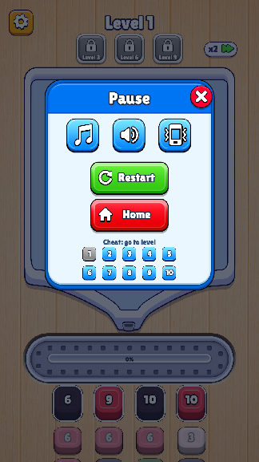</td>
<td><Badge type="tip" text="Live" /> Prototype pause panel.</td>
<td>

<b>Settings (Action Phase):</b>

<ul>
<li>Switches for Music, Sound and Vibration (kept on the device).</li>
<li><b>Restart:</b> the level starts over.</li>
<li><b>✕</b> (Resume/Close): back to the Action Phase.</li>
<li>While the popup is open (dimmed background), the Action Phase under it takes no input and the game is paused.</li>
<li>The prototype's "Cheat: go to level" row is for testing only; leave it out of the Unity game (or keep it behind a debug flag). Its red Home button (to the web landing page) is not in the Unity game either: there is no Home screen.</li>
</ul>
</td>
</tr>
</tbody>
</table>

## 3. Win

<table class="gdd-table">
<thead><tr><th style="width:26%">Wireframe</th><th style="width:16%">Compare</th><th>Detail</th></tr></thead>
<tbody>
<tr>
<td>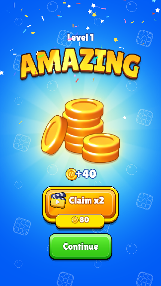</td>
<td><Badge type="tip" text="Live" /> Prototype win screen: the coin panel top right; Continue (+40) and Claim x2 (+80, no ad yet) fly the coins into it, then go on to the next level.</td>
<td>

<b>AMAZING:</b>

<ul>
<li>Confetti rains down (fireworks on both sides first, optional) on a blue background with turning rays.</li>
<li>"Level N" over the <code>AMAZING</code> title.</li>
<li>The coin pile and the reward, <b>+40 coins</b>, in the centre.</li>
<li><b>New Feature progress</b> <Badge type="warning" text="To build" />: a bar to the next unlock, "Lv 12: Shuffle" with "x/y" (levels played since the last unlock / levels needed for the next one); it shows "Unlocked" once full. The features are the boosters and the obstacles: Frozen (level 5), Activate (6), Scroll painting (10), Shuffle (12), Fan (18) (see <a href="./obstacles#_2-new-features">Obstacles</a>). After the last one the bar is removed.</li>
<li><b>Continue:</b> +40 coins (coins fly from the button to the coin counter), then the next level.</li>
<li><b>Claim x2</b> (rewarded ad): +80 coins (coins fly from the button), then go on the same way. Shown only after level 10; before that, Continue alone sits in the middle. <Badge type="warning" text="To build" /></li>
<li><b>Kill game</b> on this screen: the next launch opens the next level.</li>
</ul>
</td>
</tr>
<tr>
<td>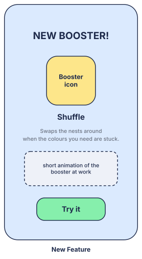</td>
<td><Badge type="warning" text="To build" /></td>
<td>

<b>New Feature:</b> when a level unlocks a booster, its unlock popup shows as that level opens, over it (a new obstacle gets its own <a href="./obstacles#_2-new-features">Obstacle Unlocked</a> popup in the same place):

<ul>
<li>The booster's name, its icon with an "Unlocked" tag and sparkles, and one line on what it does.</li>
<li><b>Claim:</b> gives 1 free use (the icon flies into its button), then the booster tutorial runs (see <a href="./ftue-tutorial#_2-booster-tutorial">FTUE & Tutorial</a>).</li>
</ul>
</td>
</tr>
</tbody>
</table>

## 4. Lose

<table class="gdd-table">
<thead><tr><th style="width:26%">Wireframe</th><th style="width:16%">Compare</th><th>Detail</th></tr></thead>
<tbody>
<tr>
<td>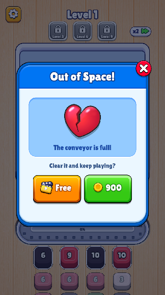</td>
<td><Badge type="tip" text="Live" /> Prototype popup: the coin panel top right; Free revives (no ad yet), 900 pays coins and revives; without enough coins it shakes and says "Not enough coins!".</td>
<td>

<b>Play On (Out of Space!):</b> when the conveyor is full and nothing on it fits a nest.

<ul>
<li>A broken heart, "The conveyor is full!", "Clear it and keep playing?"</li>
<li><b>Play On:</b> back to the Action Phase; the ball cannon (the Fan's animation) clears the belt into the nests. It does not use up the Fan booster.</li>
<li><b>Rules for Unity</b> <Badge type="warning" text="To build" />:
<ul>
<li>Play On once per level.</li>
<li>The first Play On ever is free (only the <b>Free</b> button shows); after that it costs a rewarded ad or coins (the prototype shows 900; price to tune).</li>
<li>When no ad can be shown, only the coins button shows, in the middle.</li>
<li>Holding outside the popup hides it, so the player can look at the board.</li>
</ul>
</li>
<li><b>✕ (give up):</b> the Level Failed popup.</li>
</ul>
</td>
</tr>
<tr>
<td>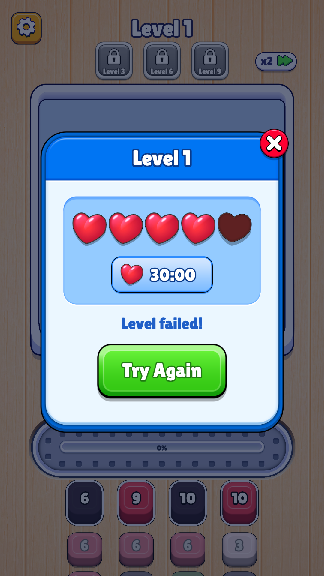</td>
<td><Badge type="tip" text="Live" /> Prototype popup (lives are shown only).</td>
<td>

<b>Level Failed:</b>

<ul>
<li>"Level N", the lives (hearts), the time to the next heart, and "Level failed!".</li>
<li><b>Try Again:</b> the level starts over (costs a life).</li>
<li><b>✕:</b> closes the popup and the level starts over, as in the prototype (there is no Home screen to go back to).</li>
<li><b>Lives</b> <Badge type="warning" text="To build" />: 5 at most; failing a level takes one; one comes back every 30:00. With no lives left, Try Again is replaced by a refill offer (ad or coins).</li>
</ul>
</td>
</tr>
</tbody>
</table>

## 5. Purchase Booster <Badge type="tip" text="Live" />

<table class="gdd-table">
<thead><tr><th style="width:26%">Wireframe</th><th style="width:16%">Compare</th><th>Detail</th></tr></thead>
<tbody><tr>
<td>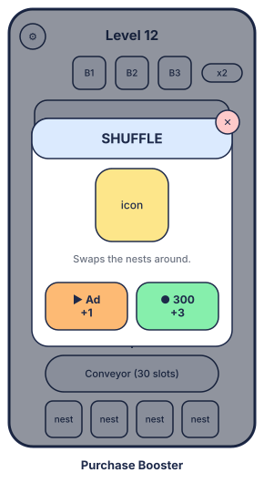</td>
<td>In the prototype: the lose panel's art, the booster's icon and line, <b>+1</b> (free, no ad yet) and <b>300 +3</b>, with the coin panel top right. Without enough coins the button shakes and "Not enough coins!" shows.</td>
<td>

Tapping a booster with no uses left (the green plus) opens its popup. The game holds still meanwhile.

<ul>
<li><b>Activate:</b> two buttons: <b>ad: +1</b> (while the daily ad cap lasts) and <b>300 coins: +3</b>.</li>
<li><b>Shuffle:</b> the same two buttons.</li>
<li><b>Fan:</b> the same two buttons.</li>
<li>After buying, the popup closes, play goes on and the booster's count goes up. ✕ closes it without buying.</li>
</ul>
</td>
</tr></tbody>
</table>

## 6. Loading screen <Badge type="warning" text="To build" />

<table class="gdd-table">
<thead><tr><th style="width:26%">REF / idea</th><th style="width:16%">Compare</th><th>Detail</th></tr></thead>
<tbody><tr>
<td>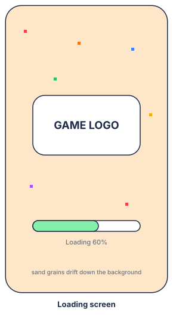</td>
<td>Not in the prototype (it shows "Loading… N%" on the wood).</td>
<td>

<b>Loading screen:</b> the first impression, shown when the game opens.

<ul>
<li>The game's logo (Sugar Drop artwork) on a still background.</li>
<li>A loading bar with the percentage.</li>
<li>Coloured sand grains drifting down the background.</li>
</ul>
</td>
</tr></tbody>
</table>

## 7. Loading transition <Badge type="warning" text="To build" />

<table class="gdd-table">
<thead><tr><th style="width:26%">REF / idea</th><th style="width:16%">Compare</th><th>Detail</th></tr></thead>
<tbody><tr>
<td>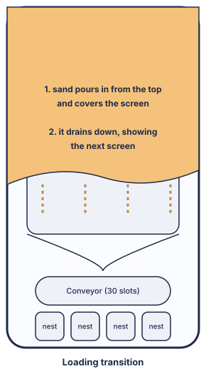</td>
<td>Not in the prototype (screens change at once; the demo reels slide one level in from the right).</td>
<td>

<b>Loading transition:</b> every change of level (Loading → level, level → level) shows it.

<ul>
<li>Coloured sand pours in from the top of the screen and covers it.</li>
<li>It drains away downward, as through the funnel, showing the new screen.</li>
</ul>
</td>
</tr></tbody>
</table>

## 8. Tutorial <Badge type="warning" text="To build" />

<table class="gdd-table">
<thead><tr><th style="width:26%">Wireframe</th><th style="width:16%">Compare</th><th>Detail</th></tr></thead>
<tbody><tr>
<td>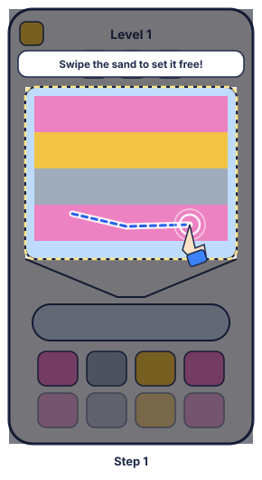</td>
<td>The prototype has the hand and its swipe paths (the demo reels' hand guide), but no tutorial.</td>
<td>

Every tutorial, step by step with wireframes, is in <a href="./ftue-tutorial">FTUE & Tutorial</a>:

<ul>
<li><b>FTUE, level 1:</b> swipe the sand, the blocks on the conveyor, ants fill the nests; a hint after 5 s idle. A popup the first time the conveyor reaches 80 %.</li>
<li><b>Booster tutorials:</b> Activate (level 6), Shuffle (12), Fan (18). Each has an unlock popup with Claim, then a hard tut with a free use.</li>
<li><b>Obstacle tutorials:</b> Frozen (level 5), Scroll painting (10). Each has the Obstacle Unlocked popup, then a short hint.</li>
</ul>

A forced tutorial that was not finished runs again on the next launch.

</td>
</tr></tbody>
</table>

## 9. Medium & Hard UI <Badge type="warning" text="To build" />

<table class="gdd-table">
<thead><tr><th style="width:26%">Wireframe / UI clone</th><th style="width:16%">Fakescreen</th><th>Detail</th></tr></thead>
<tbody><tr>
<td>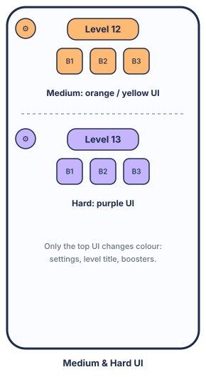</td>
<td>Not in the prototype (every level uses the orange UI).</td>
<td>

Each level has a difficulty, set in the Level Editor (very easy to very hard). In the game:

<ul>
<li><b>Normal</b> (very easy, easy): the usual UI.</li>
<li><b>Medium</b> (medium): the Action Phase's top UI (level title, Settings, boosters) turns yellow/orange.</li>
<li><b>Hard</b> (hard, very hard): the top UI turns purple.</li>
</ul>
</td>
</tr></tbody>
</table>
